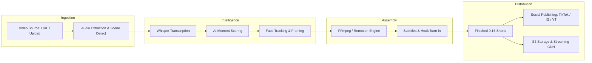

# OpenShorts

**AI Video Repurposing & Viral Shorts Platform**

OpenShorts transforms long-form videos (podcasts, webinars, livestreams, interviews) into high-performing 9:16 vertical shorts for TikTok, Instagram Reels, and YouTube Shorts. Powered by AI moment detection, face-tracking reframing, active speaker splitting, dynamic animated subtitles, and direct multi-platform scheduling.

---

## Overview

OpenShorts provides a complete video intelligence and repurposing suite:

1. **Clip Generator**
   - **Viral Moment Detection**: Leverages advanced LLM transcription scoring and scene boundary analysis to extract the most engaging moments (15–60s) with virality rankings.
   - **Intelligent Reframing**: Dynamically reframes landscape video into 9:16 vertical clips using face tracking (`MediaPipe` + `YOLOv8`), two-speaker vertical split views, and screencast layouts.
   - **Dynamic Captions**: Word-level synchronized subtitles in classic, karaoke, and custom animated styles.
   - **AI Hook Titles**: Automatically generates high-retention hook headlines placed over the first seconds of each clip.
   - **Integrated Clip Editor**: Word-level transcript editing, segment trimming, framing adjustments, and real-time previews.

2. **Autopilot & Multi-Platform Publishing**
   - **One-Click Multi-Posting**: Publish or schedule clips directly to TikTok, Instagram Reels, YouTube Shorts, Facebook, LinkedIn, Threads, and Bluesky.
   - **Channel Autopilot**: Automatically detects new long-form uploads, generates clips, and schedules them across your social channels.

3. **AI Shorts & UGC Studio**
   - Generates marketing videos with photorealistic AI actors, lip-syncing, voiceover, and b-roll for any product or landing page URL.

4. **YouTube Studio**
   - AI thumbnail generation with face extraction, viral title recommendations, and chaptered descriptions with timestamps.

5. **MCP Server & REST API**
   - Full Model Context Protocol (MCP) server support for direct control from Claude, ChatGPT, and automated workflow orchestrators (n8n, LangChain).

---

## System Architecture



### Core Technologies
- **Backend API**: Python 3.10+, FastAPI, Uvicorn, SQLAlchemy, Alembic
- **Video & Audio Processing**: FFmpeg, faster-whisper, PySceneDetect, MediaPipe, OpenCV
- **Frontend Dashboard**: React 18, Vite, Tailwind CSS, Lucide Icons, Remotion
- **Agent Integration**: Model Context Protocol (MCP) server (`mcp_server.py`)

---

## Getting Started (Development Setup)

### Prerequisites
- Python 3.10 or higher
- Node.js 18+ and npm
- FFmpeg installed with libx264 and libass support

### 1. Backend Setup
```bash
# Clone the repository
git clone <repo-url> openshorts
cd openshorts

# Create and activate a virtual environment
python3 -m venv venv
source venv/bin/activate

# Install Python dependencies
pip install -r requirements.txt

# Configure environment variables
cp .env.example .env
# Edit .env with your Google Gemini API key and credentials
```

### 2. Frontend Setup
```bash
# Navigate to the dashboard directory
cd dashboard

# Install dependencies
npm install

# Start the Vite development server
npm run dev
```

### 3. Start Backend Services
```bash
# From the repository root
python3 app.py
```
The application dashboard will be accessible at `http://localhost:5173` and the API backend at `http://localhost:8000`.

---

## Production Deployment

### Docker Deployment
The project includes multi-stage Docker configurations for CPU and GPU environments:

```bash
# Build and run with Docker Compose
docker compose up -d --build
```

---

## License

Copyright (c) 2026 OpenShorts. All rights reserved.

This software and its documentation are proprietary and confidential. Unauthorized copying, distribution, modification, reverse engineering, or commercial exploitation is strictly prohibited. See [`LICENSE`](LICENSE) for details.
